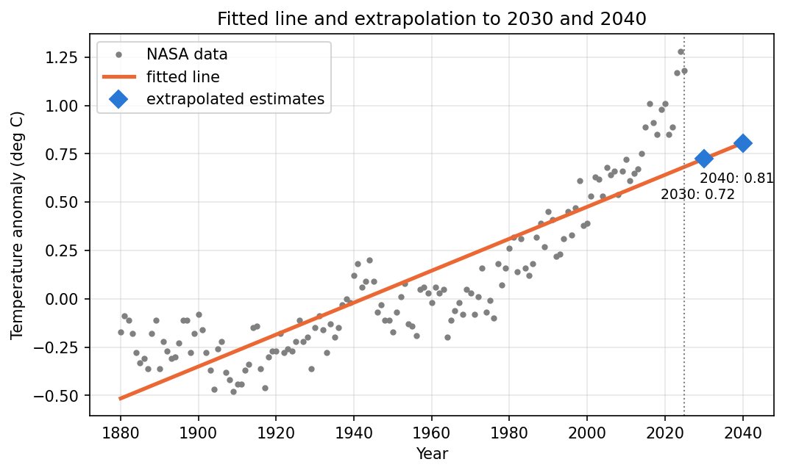

# Least Squares Fit of NASA Temperature Data

**Objective:** use NASA's historical temperature anomaly data to fit a straight line by least squares, estimate values
*inside* the observed years (interpolation) and *beyond* them (extrapolation), and measure the errors.

The whole project is **four short files, one per person**. Only one model is used: the straight line `y = a + b x`.

```bash
pip install -r requirements.txt
python person1_data.py            # load, clean, plot
python person2_regression.py      # least squares line
python person3_interpolation.py   # interpolation test
python person4_results.py         # extrapolation, MAE/RMSE, final picture
python -m pytest                  # 10 tests
```

## The data

NASA GISTEMP v4, global annual **temperature anomaly**, 1880–2025 (146 years). An anomaly is how much warmer (+) or colder (−)
a year was than the 1951–1980 average, in °C. File: `data/raw/ZonAnn.Ts+dSST.csv` (column `Glob`).

## Who did what

| Person | File | Task |
|---|---|---|
| **1** | `person1_data.py` | Load, clean and plot the NASA data |
| **2** | `person2_regression.py` | Implement least squares linear regression |
| **3** | `person3_interpolation.py` | Test interpolation on selected historical years |
| **4** | `person4_results.py` | Calculate extrapolations and MAE / RMSE; prepare the presentation |

Each file imports only from the ones before it: `1 → 2 → 3 → 4`.

### Person 1: data (`person1_data.py`)
- `load_data()` reads the file, keeps `Year` and `Glob`, turns NASA's `***` into missing values, drops repeated years, drops missing values, sorts by year. Returns two arrays: `years`, `anomalies`.
- `plot_history()` draws the anomaly against the year → `reports/history.png`.
- Result: 146 years, lowest anomaly −0.48 °C (1909), highest 1.28 °C (2024).

### Person 2: least squares (`person2_regression.py`)
For a line `y = a + b x` the error in each year is (actual − line). Least squares picks `a` and `b` to make the
**sum of squared errors** as small as possible:

```
SSE = Σ (yᵢ − ŷᵢ)²        b = Σ (xᵢ − x̄)(yᵢ − ȳ) / Σ (xᵢ − x̄)²        a = ȳ − b x̄
```

- `fit_line(x, y)` computes `a` and `b` with those formulas.
- `predict(a, b, x)` gives `a + b x`. `sse(x, y, a, b)` gives the SSE.
- `plot_fit()` → `reports/fitted_line.png`.
- Result: **y = −16.0480 + 0.008262 · year**, i.e. warming of **0.083 °C per decade**, SSE = 5.441.
- The tests check it against `numpy.polyfit`, recover an exact line, and confirm that nudging `a` or `b` makes the SSE bigger.

### Person 3: interpolation (`person3_interpolation.py`)
Interpolation means estimating a year *inside* the observed period. To test it fairly:
1. hide 14 selected years (1890, 1900, …, 2020);
2. fit the line using only the other 132 years;
3. use the line to estimate the hidden years;
4. compare with the real values. Error = estimate − actual.

`interpolate_selected()` returns the table; `plot_interpolation()` → `reports/interpolation.png`; the table is saved as
`reports/interpolation_errors.csv`. Examples: 1900 actual −0.08, estimated −0.35 (error −0.27); 2020 actual 1.01, estimated
0.64 (error −0.37).

### Person 4: extrapolation and errors (`person4_results.py`)
```
MAE  = average of |error|           RMSE = √( average of error² )
```
- `mae()` and `rmse()` implement those two formulas.
- `extrapolate()` extends the line to 2030 and 2040. `plot_final()` → `reports/final_result.png`.
- `check_extrapolation()` tests extrapolation on years we *do* know: fit through 2005, estimate 2006–2025.

## Results (from running the code)

| | MAE | RMSE |
|---|---|---|
| Line vs the data it was fitted to | 0.157 °C | 0.193 °C |
| **Interpolation** (14 hidden years) | **0.151 °C** | **0.176 °C** |
| **Extrapolation test** (fit to 1880–2005, estimate 2006–2025) | **0.442 °C** | **0.475 °C** |

| Year | Estimated anomaly (straight-line extrapolation) |
|---|---|
| 2030 | **0.724 °C** |
| 2040 | **0.806 °C** |



## What the results mean

- The line fits the data to within roughly 0.15–0.19 °C on average, and hidden years inside the data are estimated about as well (0.151 °C MAE).
- Extrapolation is **less reliable**: when the line is fitted only to 1880–2005 and asked about 2006–2025, its error is nearly three times larger
  (0.442 °C MAE), and it is always too low (average error −0.442 °C). The recent warming is faster than the long-run straight line.
  The 2030 and 2040 values above probably also under-estimate the recent trend; the future may not follow the historical linear trend.
- The 2030 and 2040 values are **simple mathematical extrapolations, not official climate forecasts.**

## Limits of this method
One straight line has the same slope for all 146 years, so it can't show warming speeding up. Interpolation here is also
tested on only 14 years, so its error numbers are rough.

## Files
```
person1_data.py  person2_regression.py  person3_interpolation.py  person4_results.py   the project
data/raw/ZonAnn.Ts+dSST.csv                                                           NASA data
reports/   history.png  fitted_line.png  interpolation.png  final_result.png
           interpolation_errors.csv  extrapolation.csv                                  outputs
```
