# ClimateMatrix: results

Data: NASA GISTEMP v4 zonal annual anomalies (°C vs 1951–1980), 1880–2025, 146 years, eight non-overlapping
latitude bands. All numbers below are produced by `python scripts/run_all.py` and saved in `reports/tables/`.

> **Important context.** This annual zonal table contains **no missing values**. Every "missing" observation
> in this study is hidden on purpose, so every method is scored against a known truth. Real gaps (for example
> from sparse early station coverage) may behave differently from randomly placed ones.

## 1. Interpolation (Part 1)

Hide 20% of the global series, reconstruct from the rest, repeat 200 times. RMSE in °C (MAE follows the same ordering):

| method | isolated years | 3-yr gaps | 5-yr gaps | 10-yr gaps |
|---|---|---|---|---|
| **linear** | **0.087** | **0.109** | **0.114** | **0.119** |
| Lagrange, 4-point local | 0.090 | 0.144 | 0.166 | 0.230 |
| cubic spline (natural) | 0.093 | 0.150 | 0.180 | 0.268 |
| Lagrange, 6-point local | 0.097 | 0.202 | 0.309 | 0.841 |

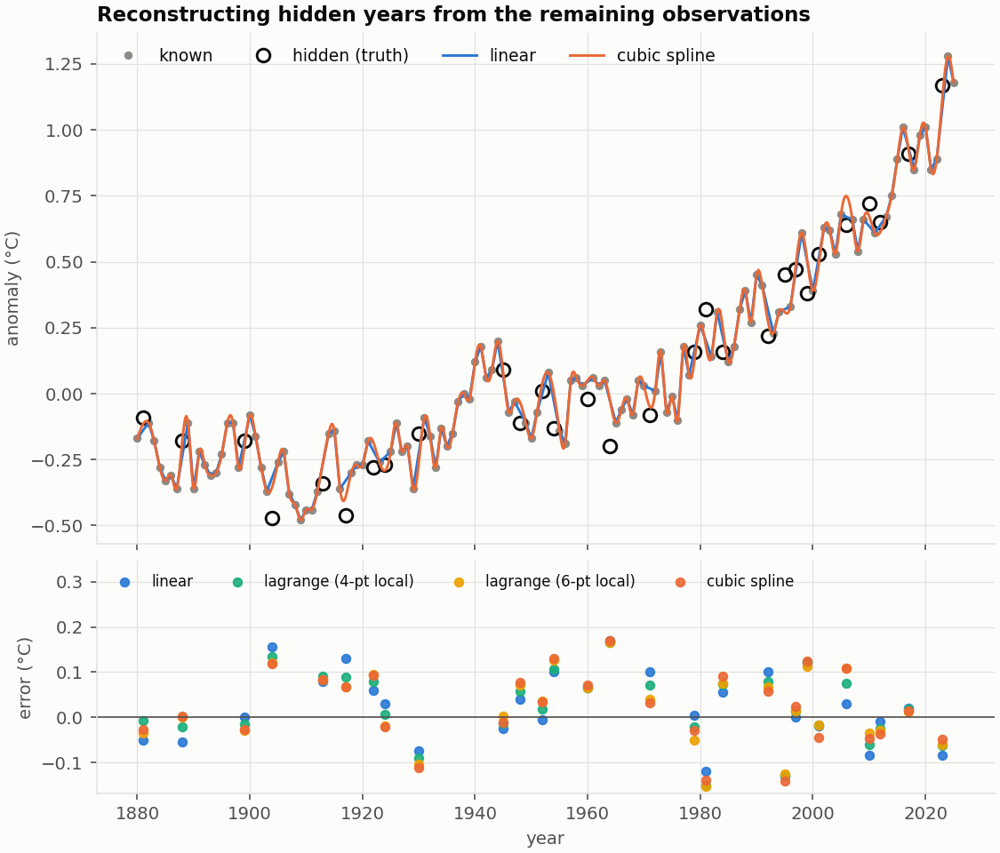

**Linear interpolation wins, and the gap widens as gaps get longer.** Annual anomalies are a smooth trend plus
interannual noise of about 0.1 °C. Higher-order interpolants pass exactly through that noise and then
extrapolate it across the gap, so smoother does not mean better here. Linear interpolation also doesn't amplify noise
(factor 0.92); the cubic spline roughly passes it through (1.02).

**A single global Lagrange polynomial through all points fails.** With 12 nodes it is fine (RMSE 0.15), at 16 it
is 7.7 °C, and at 40 it is 5×10⁶ °C. The Vandermonde condition number reaches 6×10¹⁷, beyond 1/ε ≈ 4.5×10¹⁵. It
amplifies noise in the data by a factor of about 13,000 (25 nodes). That is the Runge phenomenon, which is why local Lagrange
windows are used elsewhere.

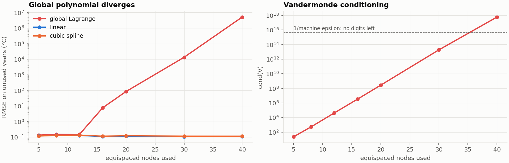

## 2. Regression and extrapolation (Part 2)

Fit of global anomaly on time (τ = centred, scaled year), solved by QR:

| model | RMSE | R² | lag-1 residual autocorr. | 2030 | 2040 | 2050 |
|---|---|---|---|---|---|---|
| linear | 0.193 | 0.765 | 0.83 | 0.72 (0.33–1.11) | 0.81 (0.42–1.20) | 0.89 (0.50–1.28) |
| quadratic | 0.120 | 0.910 | 0.56 | 1.13 (0.88–1.38) | 1.37 (1.11–1.62) | 1.63 (1.36–1.89) |
| cubic | 0.115 | 0.916 | 0.53 | 1.25 (0.99–1.50) | 1.58 (1.30–1.86) | 1.96 (1.64–2.28) |

(95% prediction intervals in brackets.) Coefficients are in `reports/tables/p2_coefficients.csv`.

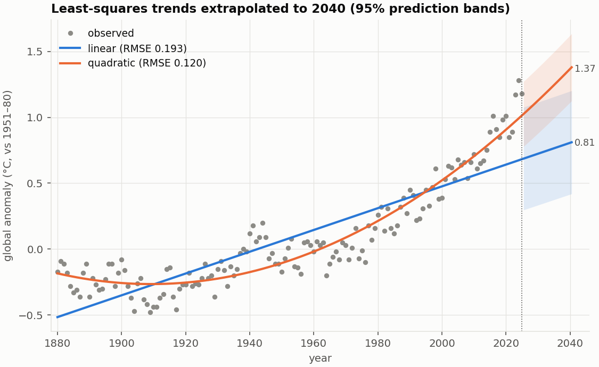

**Train on 1880–2005, forecast 2006–2025:**

| model | train RMSE | test RMSE | test bias |
|---|---|---|---|
| linear | 0.147 | 0.475 | −0.442 |
| quadratic | 0.117 | 0.187 | −0.138 |
| cubic | 0.117 | 0.150 | −0.096 |

A straight line trained on the past under-predicts the last 20 years by 0.44 °C on average: warming accelerated.

**Rolling-origin backtest** (every origin from 1919 on, forecast the next 10 years, 970 forecasts per model):

| model | RMSE | MAE | bias | 95% interval coverage |
|---|---|---|---|---|
| linear | 0.236 | 0.193 | −0.169 | 68% |
| **quadratic** | **0.168** | **0.135** | +0.010 | 86% |
| cubic | 0.212 | 0.160 | −0.033 | 80% |

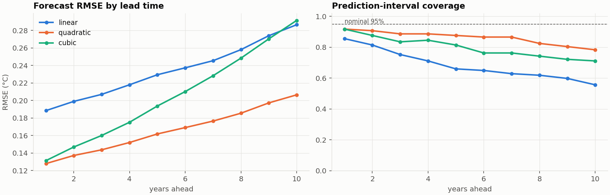

- **Quadratic is the best of the three at forecasting** even though cubic fits the history slightly better (more flexibility
  extrapolates worse).
- **The prediction intervals are too narrow.** A nominal 95% interval contained the truth only 68–86% of the time,
  because the independent-errors assumption fails: residuals are strongly autocorrelated (lag-1 r = 0.53–0.83).
- **Normal equations vs QR.** With raw years in the design matrix, cond(X) = 9×10⁹ (quadratic) and cond(XᵀX) = 8×10¹⁹,
  far beyond 1/ε, so the normal equations lose all precision (fitted-value error up to 5×10⁻⁷ °C for cubic, versus 10⁻¹⁶ when time is centred). Centring and scaling time brings cond(X)
  to 1.7–8. See `p2_conditioning.csv`.

## 3. SVD of the region × year matrix (Part 3)

A is 8 × 146 (regions × years), centred by subtracting each region's own mean. (Row centring removes the baseline
offset so the SVD describes *variation*; column centring and area weighting are available in the dashboard.)

| component | 1 | 2 | 3 | 4 | 5 |
|---|---|---|---|---|---|
| variance explained | 71.7% | 19.8% | 4.7% | 1.6% | 1.0% |
| cumulative | 71.7% | 91.6% | 96.3% | 97.8% | 98.9% |

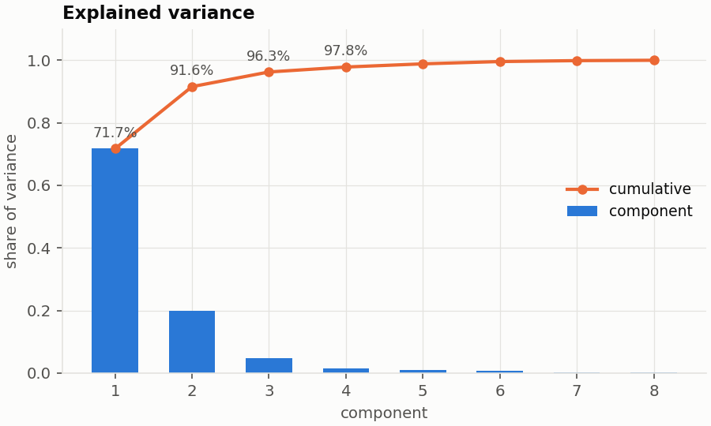

- **Mode 1** (72%) has the same sign in every band, with the Arctic largest and a time series that is the global warming
  trend: warming is a shared signal, amplified at high northern latitudes.
- **Mode 2** (20%) is dominated by the Antarctic band (90S–64S) with the opposite sign in the Arctic. Treat this one cautiously:
  station coverage near the South Pole is sparse before the late 1950s, so part of this mode may reflect data quality
  rather than climate.
- **Rank 2 reconstructs the matrix to 0.17 °C RMSE (29% relative Frobenius error); rank 3 to 0.11 °C.** The measured
  Frobenius error equals √Σ_{i>k}σᵢ² to machine precision at every rank (Eckart–Young), confirmed by the tests.

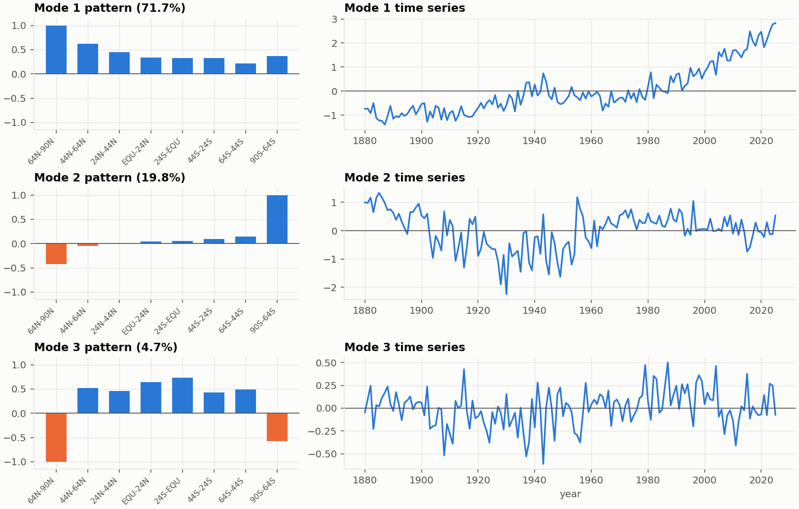
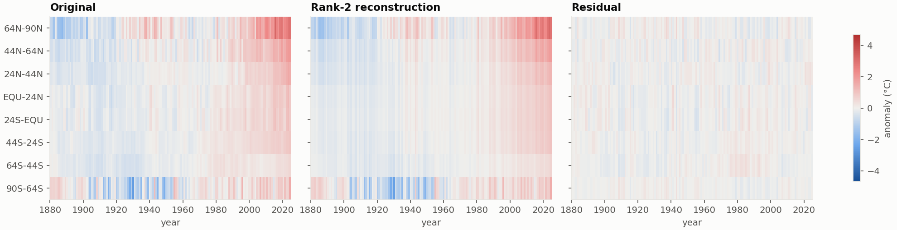

## 4. Head-to-head validation (Part 4)

### 4a. Reconstructing hidden matrix entries (8 × 146, 30 random masks each)

Time-only methods use each region's own series. Low-rank methods use all regions at once. RMSE in °C:

| method | random gaps (20% hidden) | 5-year block gaps (3 per region) |
|---|---|---|
| **linear (time only)** | **0.312** | **0.335** |
| SVD soft-threshold, λ=1 | 0.358 | 0.345 |
| cubic spline (time only) | 0.391 | 0.605 |
| SVD rank 1 | 0.414 | 0.394 |
| SVD rank 2 | 0.525 | 0.469 |
| row mean (rank 0) | 0.585 | 0.563 |
| SVD rank 3 | 0.783 | 0.836 |
| SVD rank 4 | 0.847 | 1.017 |

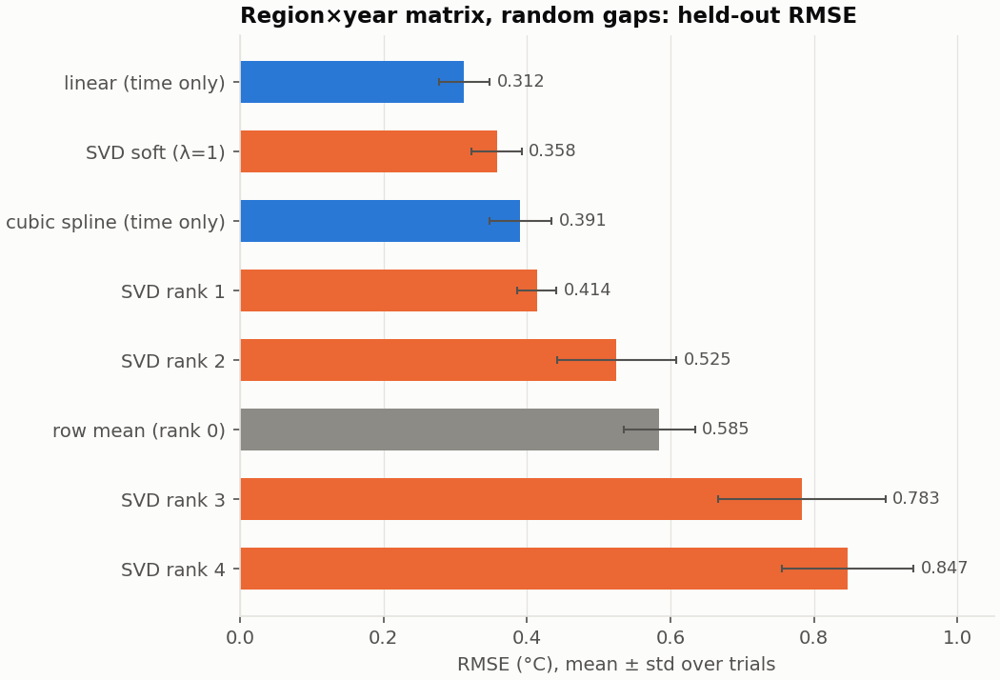

**Cross-region information helps (rank 1 beats the row-mean baseline by about 30%), but it does not beat simple temporal
interpolation on this data.** In-sample error always falls as rank grows (0.31 → 0.17 → 0.11 for k = 1, 2, 3), while
error on hidden entries is lowest at k = 1 and gets *worse than the baseline* from k = 3. With only 8 regions, a year
with several gaps leaves fewer observations than free parameters. This is overfitting, not a bug: the same completion
code recovers an exact rank-2 matrix (error below 1e-4) and degrades the same way past the true rank (tested in `tests/test_svd.py`).
Shrinking singular values instead of truncating (soft-threshold) removes most of the damage and nearly matches linear
interpolation on block gaps (0.345 vs 0.335). An informal check of a hybrid (average of linear and soft-threshold with λ=3, 20 random masks) gave 0.312
vs 0.320 for linear alone; too small a difference to claim, so it is not part of the shipped code.

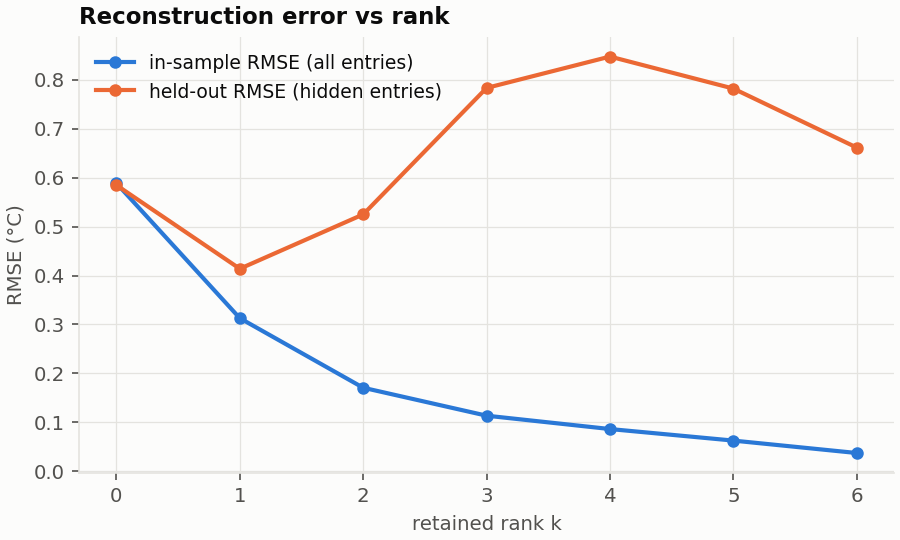

### 4b. Sensitivity to the training period

Forecast for 2040 using the same model but a different first training year:

| training starts | linear | quadratic |
|---|---|---|
| 1880 | 0.81 | 1.37 |
| 1900 | 0.92 | 1.37 |
| 1920 | 0.98 | 1.49 |
| 1940 | 1.07 | 1.72 |
| 1960 | 1.27 | 1.62 |
| 1980 | 1.36 | 1.75 |

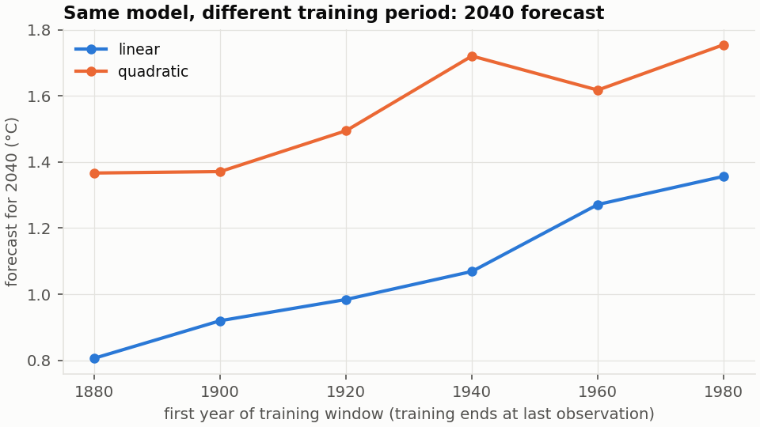

The 2040 forecast moves by **0.55 °C (linear) and 0.38 °C (quadratic)** just from choosing where the training window
starts, comparable to the width of the prediction interval itself. Ten-year-ahead RMSE across (training start, forecast origin)
ranges from 0.06 to 0.84 °C (`p4_training_sensitivity.csv`); the worst cell is a quadratic fitted to only 11 years (1980–1990).

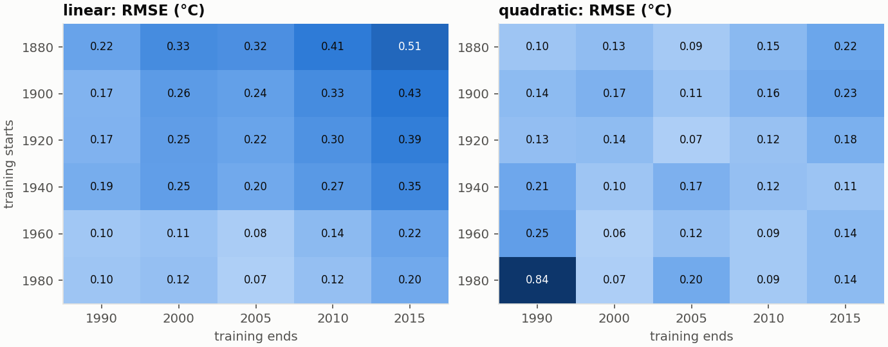

## Answer to the research question

1. **Reconstruction.** Both families work. Linear interpolation recovers hidden annual values to about 0.09 °C (isolated
   years) and 0.12 °C (10-year gaps), and is the most reliable method tested. Low-rank completion from neighbouring regions
   cuts the error of a row-mean guess by 29% (rank 1) to 39% (soft-threshold), but only with a small rank or shrinkage, and it is not better than
   interpolating along time for this annual data.
2. **Dominant patterns.** Two components carry 92% of the variance; the first is the common, polar-amplified warming trend.
3. **Extrapolation is much less reliable than reconstruction.** Backtest forecast error (RMSE 0.17 °C for the best model at 1–10 years)
   is nearly double the interpolation error, interval coverage is 68–86% instead of 95%, and the 2040 estimate depends
   on the training window and polynomial degree (0.8–1.75 °C across reasonable choices). Better in-sample fit
   (cubic) did not mean better forecasts.

## Limitations

- Statistical curve fitting only: polynomials extrapolate a shape, not physics. The values for 2030–2050 above are
  illustrations of method behaviour, not climate projections.
- Not implemented: the brief's "time plus a selected climate indicator" regression. It needs a second dataset (e.g. CO₂ or
  an ENSO index); `design_matrix` is written so extra columns can be added, but none are included.
- Splines use natural end conditions (implemented from scratch and tested against SciPy). Not-a-knot is not provided.
- Hidden points are placed at random, and endpoints are never hidden, so extrapolation at the ends of the record is
  measured separately (Part 2), not under "interpolation".
- Gaps in real data are not random (early records are sparser at the poles), and 8 regions is a small matrix, which limits
  what low-rank completion can do. Gridded GISTEMP data (NetCDF, thousands of rows) would be the natural next step.
